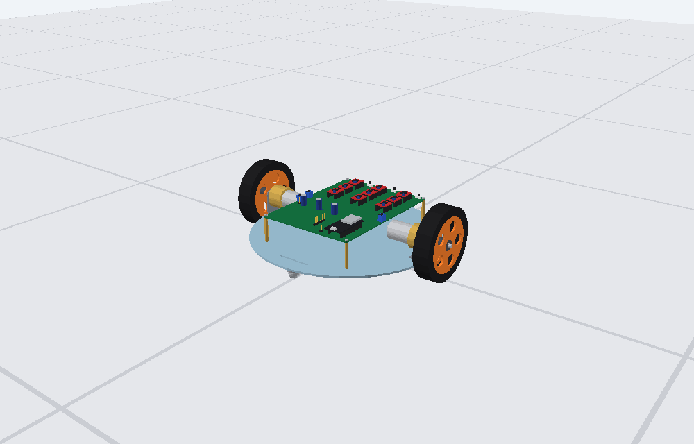
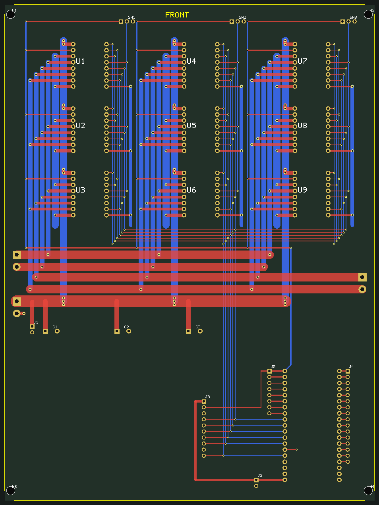
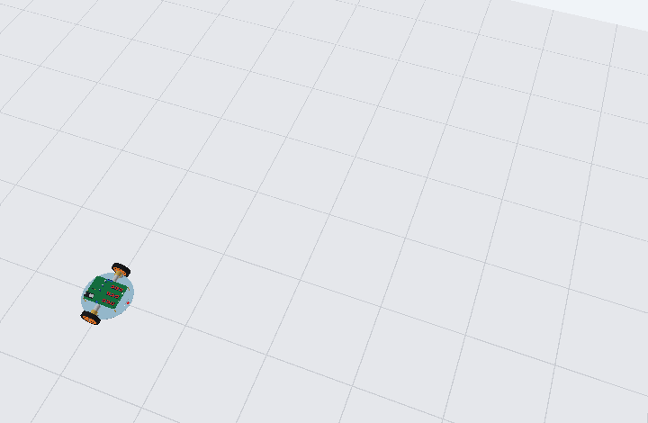

# RocketBoy – simulator, 9 × TB6612FNG parallel driver board, 3D model

A circular (Ø300 mm) differential-drive robot: two SG-3851218000-60K 12 V gear-motors on L-clamps, two ball casters,
a 3S Molicel pack underneath, and a PCB on top with **9 TB6612FNG modules in parallel** (3 × 3 grid, three enable switches),
an ESP32 DevKit socket and header pins for **every unused ESP32 pin plus a 10-pin expansion header** so a top PCB can be plugged on.



## Quick start – the simulator (this is the thing to submit)

**Double-click `RocketBoy_Simulator.html`** (Chrome, Edge or Firefox; one file, no install, no internet, no server).

| control | action |
|---|---|
| `W` `A` `S` `D` or arrow keys (or the on-screen ▲◀▼▶, hold) | drive / steer (A = left) |
| `Space` | cut power (coast to a stop) |
| **Run hard-coded route** | the robot drives a square with 90° spins by itself (any drive key takes over) |
| `R` / `P` | reset / pause |
| `1` `2` `3` (or the SW1–SW3 boxes) | switch the three STBY enable switches = 3, 6 or 9 driver modules per motor |
| max duty, soft start, sim speed | sliders / tick boxes (turn soft start off to see the 7 A inrush) |
| jam the wheels | stall test: with only SW1 on the module tiles turn red (> 1.2 A rating) |
| mouse drag / wheel, `C` | orbit / zoom the camera, chase-cam on/off |

The window shows the 3D robot, speed / yaw rate, motor currents, battery voltage and charge, the 3×3 module grid (current of each TB6612 module against its 1.2 A rating)
and rolling current / voltage charts.

Verification that was run: the JavaScript model gives **bit-identical** results to the Python model (`python3 simulation/test_js_parity.py`),
and a headless UI test drives it with synthetic key presses (`node simulation/test_simulator_ui.js`). I could not open it in a real browser here,
so if something looks off on your machine tell me the browser and what you see.

Optional (needs Python 3, nothing to install): `python3 simulation/run_all.py` re-runs the batch scenarios (launch, stall, hill, spin, route, PCB copper check)
and writes plots/CSV/`summary.md` to `simulation/results/`; `python3 simulation/build_web_sim.py` rebuilds the HTML.

## 1. How much current?

| situation (simulated) | current per motor | modules needed |
|---|---|---|
| steady driving, flat, 1.73 m/s | **0.5 A** (motor no-load current) | 1 |
| hard-coded route (square with spins) | mean 0.8 A while moving, peak 2.5 A | 1 group (3 modules = 3.6 A rated) |
| 25° ramp at duty 0.7 | 1.2 A | 1 |
| tyres at the traction limit (wheel spin, ≈ 34° slope; also what happens when pushing a wall) | ≈ 1.4 A | 1 |
| **full-duty step from standstill (inrush)** | **6.8 A for ~50 ms** | soft-start the PWM (route uses 3 duty/s) |
| **wheels jammed / gearbox locked** | **6.1 – 6.5 A per motor (7.5 A on the bare 12 V terminals), ≈ 13 A from the battery for both** | ≥ 2 groups (or stall-detect in firmware) |

One group (3 modules per motor channel: 3.6 A continuous, 9.6 A pulse) covers all normal driving; groups 2 and 3 (6/9 modules, 7.2/10.8 A) are insurance for jams and heavier motors.

> **Stall current = 7.5 A (your figure)**; the stall rows in `Johnson Motor.pdf` are blank. The model uses R = 12 V / 7.5 A = 1.6 Ω and takes Ke from the 300 rpm no-load point
> (stall torque ≈ 25 kgf·cm, derived). Cross-check: it gives 229 rpm at 6 kgf·cm against 220 ± 22 rpm in the PDF, so the two agree. In the robot the pack, driver and wiring resistance
> bring the stalled current down to 6.1 – 6.5 A. Change `I_STALL` in `simulation/params.py` to try other values.

## 2. Mistakes found in the original design and what was changed

| # | original | problem | fix |
|---|---|---|---|
| 1 | ESP32 `5Vin` on net `VCC` = battery (9 – 12.6 V) | over-voltages the DevKit regulator / USB rail | new `+5V` net from an external buck module (`J1` in, `J2` out); battery net renamed `VBAT` |
| 2 | `STBY` of all modules tied to `VCCQ` | no enable switches – modules always on | `STBY1…3` per group (= per PCB column: U1-3, U4-6, U7-9), SPDT slide switches `SW1…3` (ON → 3V3, OFF → GND) |
| 3 | ESP32 pad 21 tied to GND | on the 38-pin DevKit that pin is `CMD` (flash line) | left open (no-connect) |
| 4 | no outline / holes, a few 0.2 mm tracks | board unfinished | 155 × 208 mm outline, 4 × Ø3.2 mm holes on the STEP pattern (±75, ±100 mm), fully routed, B.Cu GND pour |
| 5 | 1.9 mm pads for battery/motors | cannot carry 6 A | 5.08 mm screw terminals, 3 – 5 mm trunks, 2 oz copper recommended |
| 6 | no bulk capacitance | motor-supply spikes | `C1–C3` 470 µF / 25 V on VBAT |
| 7 | no way to attach a controller / top board | – | headers `J3`, `J4`, `J5` (below) |
| 8 | *(my own earlier error)* clamps shown under the chassis | the 26.7 mm axis height is from the flange face, so under the plate the chassis would be 76 mm off the floor | clamps are on the **top** face; wheel Ø110 → chassis top 28.3 mm, underside 25.3 mm above the floor |

Not verifiable here, please check against your parts: the TB6612 breakout pin order (`pad 6 = BO1, pad 7 = BO2` was kept; if your module prints BO2 first the right motor
just runs reversed – swap the wires), and the ESP32 DevKit pinout. GPIO12 (AIN1) is the flash-voltage strapping pin; do not add a pull-up.

### Header pins for a top PCB (all 2.54 mm, shown as tall male pins in the 3D model; the PCB has the plated holes, fit sockets or pins as you prefer)

* **`J5`** – west ESP32 row, 1×8: `1 3V3 · 2 EN · 3 GPIO36 · 4 GPIO39 · 5 GPIO34 · 6 GPIO35 · 7 GPIO32 · 8 GPIO33` (GPIO34-39 are input-only, usable as ADC1).
* **`J4`** – east ESP32 row, 1×16: `1 GND · 2 GPIO23 · 3 GPIO22 · 4 GPIO1/TX0 · 5 GPIO3/RX0 · 6 GPIO21 · 7 GND · 8 GPIO19 · 9 GPIO18 · 10 GPIO5 · 11 GPIO17 · 12 GPIO16 · 13 GPIO4 · 14 GPIO0 · 15 GPIO2 · 16 GPIO15`.
  GPIO0/2/5/12/15 are boot-strapping pins – keep them high-impedance at reset.
* **`J3`** – expansion, 1×10: `1 5V · 2 3V3 · 3 GND · 4 BIN1 · 5 BIN2 · 6 PWMB · 7 AIN2 · 8 AIN1 · 9 GND · 10 PWMA` – the motor-control nets (same as ESP32 GPIO25/26/27/14/12/13).
  To drive the motors from another board, **remove the ESP32** so two outputs never fight. STBY stays on the three slide switches.
* Not broken out: GPIO6-11 (connected to the DevKit's flash – unusable) and the pins already used by the driver bank (GPIO12/13/14/25/26/27).
* The top board can sit on the same four M3 holes (150 × 200 mm pattern) with longer standoffs.

## 3. PCB (`RocketBoy/RocketBoy.kicad_pcb`)



* 2 layers, A3 sheet, **155 × 208 mm** (155 keeps clear of the motors' rear bosses), board centre = chassis centre, **front = top edge** (switches at the front edge, USB of the ESP32 at the rear edge).
* **Architecture** – one column of three modules = one enable group: each module pin goes by a short `F.Cu` stub to a via; vertical `B.Cu` "bus lanes" run along the column
  (VBAT 3 mm, GND 3 mm, motor outputs 2 mm, logic 0.3 mm); the lanes of the three columns are joined by horizontal `F.Cu` trunks (VBAT 5 mm, motor outputs 3.5 mm) that end at the battery / left / right motor
  screw terminals (`BT1`, `U11`, `U12`); the six control lines continue to the ESP32 control pins and `J3`.
* Parts added: `SW1–3`, `C1–3`, `J1/J2` (5 V buck in/out), `J3/J4/J5` (headers above), `H1–H4` (M3). Their footprints/symbols are in `RocketBoy/RocketBoy.pretty` and `RocketBoy.kicad_sym`
  (registered via `fp-lib-table` / `sym-lib-table`); your original `Control_Modules:` and `MCU:` footprints are untouched. Recommended in the battery lead: 10 A fuse and a main switch.

Checks run (KiCad is not available in the build environment – **please run KiCad's ERC/DRC once and press B to fill zones**):

| check | result |
|---|---|
| independent clearance check, all copper, 0.20 mm rule | 0 violations |
| every non-GND net electrically connected | all connected |
| flood-fill of the B.Cu pour (0.4 mm clearance) | every GND pad / via / lane reaches the main pour |
| edge ≥ 0.5 mm, drill-to-drill / drill-to-copper ≥ 0.25 mm | 0 violations |
| schematic netlist vs PCB netlist (`tools/compare_netlists.py`) | identical (38 nets) |

## 4. Mechanics and 3D model (`model3d/out/`)

* Inputs: `Chassis file.step` (Ø300 × 3 mm disc, PCB holes ±75 / ±100, 12 clamp holes, caster slots), `L Clamp.pdf` (1.5 mm steel, flange 22 mm, Ø22 bore + 12 holes, axis 26.7 mm above the flange),
  `Johnson Motor.pdf` (gearbox Ø37 × 25, can Ø29 × 37.8, Ø6 × 30 shaft).
* Clamps on the **top** face, motors inwards, wheels outside. **Wheel Ø110 × 25 mm (assumed)** → chassis underside 25.3 mm above the floor (room for the 3 × 18650 pack, buck module, voltage indicator; casters 25.3 mm tall).
  PCB on four **M3 × 40 mm** standoffs so it passes above the motor rear bosses.
* Files: `rocketboy_assembly.stl` (+ body / wheel STLs), `rocketboy.obj/.mtl`, `rocketboy_route.gif` (the route animation), `preview_*.png`. Units mm, x = wheel axis, y = forward, z = up.
  A visual / fit model rebuilt from the STEP's dimensions, not a converted STEP. Rebuild: `python3 model3d/make_outputs.py`.



## 5. Simulation model and results

3S Li-ion (OCV curve + 101 mΩ) → TB6612 bank (random ±25 % R_on spread decides how current shares between modules) → DC motors fitted to the datasheet rated point →
tanh tyre-force model → differential-drive body. Hard-coded route: 4 × [drive 2 s at duty 0.6, pause, spin left 0.368 s (calibrated to 90°), settle], duty slew-limited to 3/s.
Results (see `simulation/results/summary.md`): top speed 1.73 m/s, 0 → 1 m/s in 0.18 s, spin 272 °/s; route 15.2 s / 7.9 m, ends 91 mm and +3.7° from the start (open loop drifts),
peak 2.6 A, 6.9 mAh, battery ≥ 11.73 V, worst module 1.11 A. A PCB copper check (S6) compares the trace widths in the PCB file with the currents (2 oz copper needed for a jam; with both motors jammed the 5 mm VBAT trunk carries 13.4 A, slightly above its 12.7 A rating, so use a **10 A fuse**).

Assumptions (all in `simulation/params.py`): mass 2.2 kg, 1:60 gearbox and rotor inertia, wheel, tyre μ 0.8, battery 2.8 Ah / 22 mΩ per cell, R_on 0.5 Ω ± 25 %.
Not modelled: lateral tyre slip, motor inductance (PWM-averaged), thermal behaviour, collisions.

## 6. Firmware (`firmware/rocketboy_hardcoded/`)

ESP32 sketch that runs the same route (20 kHz LEDC PWM, schematic pins, 5 ms loop, same slew limit); `route.h` is generated from the simulation. **Not tested on hardware** – lift the wheels first.

## 7. Reproducing

```
python3 simulation/run_all.py          # batch scenarios + route.h + route_30hz.json
python3 simulation/build_web_sim.py    # RocketBoy_Simulator.html
python3 simulation/test_js_parity.py   # JS model == Python model
node simulation/test_simulator_ui.js   # headless UI test
python3 model3d/make_outputs.py        # STL / OBJ / GIF / renders
python3 tools/build_pcb.py && python3 tools/build_sch.py && python3 tools/compare_netlists.py   # KiCad files (start from tools/originals/)
```
Re-running the KiCad generators overwrites hand edits made in KiCad afterwards – treat them as the one-time "design completion" step.
